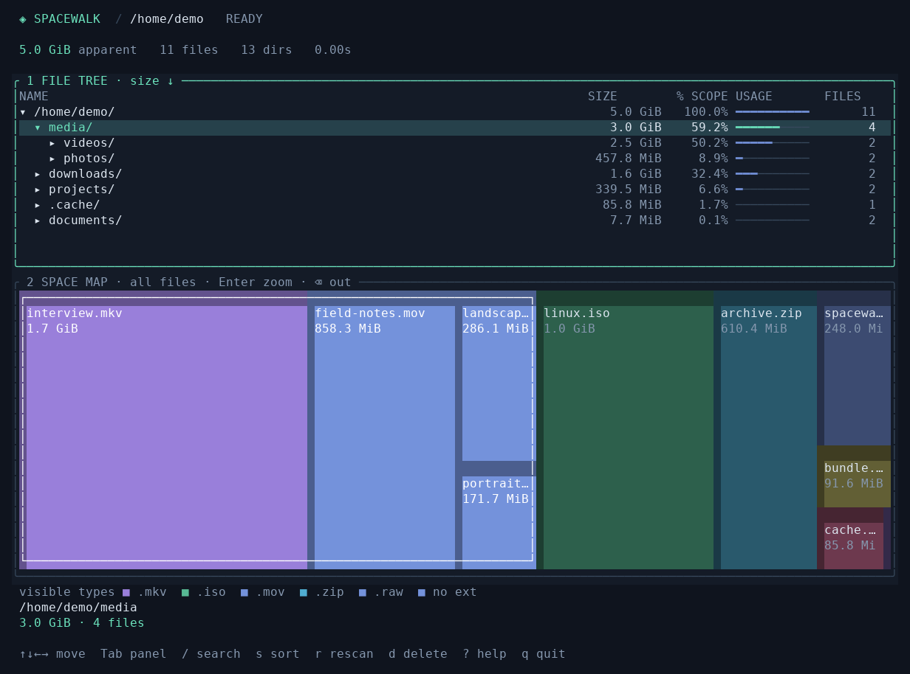

# Spacewalk

A Rust terminal disk usage explorer inspired by WinDirStat. Browse a file tree above a proportional treemap, with one selection shared between both panels.



## Installation

### From a release

Install the latest published release:

```sh
curl -fsSL https://raw.githubusercontent.com/mattslaney/spacewalk/main/install.sh | sh
```

Prebuilt binaries are available for Linux and macOS on x86_64 and ARM64.
The installer verifies the download's SHA-256 checksum and installs to
`~/.local/bin`. No Rust toolchain or root access is required. Run the same
command again to update.

If needed, add the installation directory to your PATH:

```sh
export PATH="$HOME/.local/bin:$PATH"
```

To download the script separately and choose a version or installation directory:

```sh
curl -fsSL https://raw.githubusercontent.com/mattslaney/spacewalk/main/install.sh -o install-spacewalk.sh
sh install-spacewalk.sh --version v0.1.0 --install-dir "$HOME/bin"
```

`SPACEWALK_VERSION` and `SPACEWALK_INSTALL_DIR` also set these options.
Remove `~/.local/bin/spacewalk` to uninstall the default installation.

You can also download archives and checksums from
[GitHub Releases](https://github.com/mattslaney/spacewalk/releases). If no release
is available for your platform, build from source.

### From source

Requires Rust 1.88 or newer:

```sh
cargo install --git https://github.com/mattslaney/spacewalk.git --locked
```

Or install from a local checkout:

```sh
make install                 # Or: cargo install --path . --locked
```

Cargo installs to `~/.cargo/bin` by default. To use a different prefix, run
`make install INSTALL_ARGS='--root /path/to/prefix'`; the executable goes in that
prefix's `bin` directory.

## Usage

Spacewalk needs a terminal with at least 60 columns and 20 rows for its interactive
interface. A Unicode font and true color support give the best results.

Run `spacewalk` to explore the current directory, or pass a path. Hidden files are
included.

```sh
spacewalk ~/Downloads
spacewalk . --apparent-size   # Logical lengths rather than allocated blocks
spacewalk . --summary         # Plain text output, including when piped
spacewalk --help
```

## Controls

| Key | Action |
| --- | --- |
| Tab / Shift+Tab | Switch focus between tree and map without changing selection |
| ↑ / ↓, j / k | Move through tree rows, or between map blocks by position |
| ← | Collapse in the tree, or move left in the map |
| → / l | Expand in the tree, or move right in the map |
| Space | Toggle the selected directory in the tree |
| Enter | Zoom into the selected directory; on a map file, zoom into its parent |
| Backspace | Zoom out one directory |
| Home / End, g / G | First / last visible tree row |
| PageUp / PageDown | Move a page through the tree |
| / | Start live, case-insensitive name filtering |
| Enter while searching | Keep the filter and return to navigation |
| Esc | Clear the filter, cancel deletion, or close a dialog |
| n / N | Next / previous matching name in the current scope |
| s | Cycle sort: largest, name, file count, smallest |
| y | Copy the selected item's full path to the system clipboard |
| c / x / p | Queue items for copy / cut / paste |
| a / R | Create a folder / rename the selected item |
| F3 / F4 | Show or hide operation progress / request cancellation |
| Ctrl+g | Open Git reports, sync, cleanup and worktree management |
| t | Open a shell in the selected directory, or the parent of a selected file |
| r | Rescan the original directory and preserve the current view where possible |
| h | Hide / show the selected file or directory in the treemap |
| H | Show all hidden items again |
| m / M | Mark or unmark the selected item for batch actions / clear all marks |
| d / Delete | Ask to permanently delete marked items, or the selected item if none are marked |
| e | Show scan errors |
| ? / F1 | Open help |
| q / Ctrl+C | Quit; a deletion already in progress finishes first |

Click either panel to focus it and select an item. In the tree, click a directory's triangle to expand or collapse it. A map click expands the selected file's ancestors and scrolls it into view in the tree. Double-click a block to zoom into its parent directory; right-click the map to zoom out. The wheel over the tree moves its selection. Arrow keys and PageUp/PageDown scroll dialogs.

Press `y` in either panel to copy the selected item's absolute path, including spaces and Unicode characters, without quotes or a trailing newline. Clipboard copying runs in the background and reports success or unavailability below the selection details. Linux needs `wl-copy` from `wl-clipboard` for Wayland, or `xclip`/`xsel` for X11, with access to the desktop session. macOS uses `pbcopy`; Windows uses PowerShell's `Set-Clipboard`. Clipboard support is optional; navigation continues normally when no clipboard is available.

Use `c` or `x` to queue the selected item, or all marked items, for copying or
moving. Navigate to a destination and press `p`. The paste dialog shows the queued
items and an editable destination directory; Tab completes an unambiguous directory
name. Enter confirms and Esc cancels the dialog. Queued transfers are separate from
the system clipboard. Copy queues can be pasted repeatedly; successfully moved
items leave the cut queue. Esc outside a dialog clears the transfer queue.

Press `a` to create a folder in the selected directory (or the parent of a selected
file), or `R` to rename the selected item. Existing destinations are never
overwritten or merged. Directory copies preserve symbolic links as links, file
permissions, file modification times, and sparse zero-filled regions. Ownership, ACLs,
extended attributes, and hard-link relationships are not copied. Moves work across
filesystems; cross-filesystem moves finish the copy before removing the source.
The scan root cannot be moved or renamed.

File operations open a floating progress panel showing the action, destination,
elapsed time, and recent activity, including byte counts during large file copies.
Esc hides the panel so you can keep browsing; F3 reopens it. F4
requests cancellation; completed items are kept and unfinished cut items stay
queued. The result dialog reports failures and partial completion, and disk usage
refreshes automatically. Other mutations and shell launches wait until the operation
finishes. Quitting requests cancellation and waits for the worker to stop safely.

Completion notices and other temporary action messages clear after three seconds, revealing the selected item's details again.

Press `t` in either panel to open an interactive shell in the current terminal. A selected file or symbolic link opens its parent directory. Unix uses `$SHELL` (falling back to `/bin/sh`); Windows uses `%COMSPEC%` (falling back to `cmd.exe`). Type `exit` to return to the same selection, expanded tree, and deletion marks. Press `r` afterward to refresh disk usage and Git indicators if commands changed anything. Finish the current scan or deletion before opening a shell.

Repository roots have a `⎇` icon in the tree, including linked worktrees, submodules, and bare repositories. Status icons appear alongside it:

| Icon | Meaning |
| --- | --- |
| `…` | Background check in progress |
| `✓` | Clean working tree; every local branch matches its remote upstream |
| `*` | Staged, unstaged, or untracked changes |
| `↑` / `↓` | At least one local branch is ahead of / behind its remote upstream |
| `∅` | No remote is configured |
| `?` | Status unverified: unavailable Git, unfetched remote, missing upstream, or a branch without a remote upstream |
| `◇` | Detached HEAD; sync is unverified |
| `≡` | Stashed changes exist |

Green means synced, purple identifies repositories without remotes, amber marks other local or uncertain state, and gray means checking. Select the repository for a text explanation below the panels; `?` opens the icon legend. Checks run once in the background after each scan, use all local branches, and leave navigation responsive. Remote comparisons use **last-fetched local refs**; automatic status checks do not fetch or contact remotes. Use the Git action panel or fetch in the shell, then press `r` to rescan and recheck. A clean checked-out branch alone is not enough for `✓`: other local branches, missing upstreams, detached HEAD, and stashes also prevent it.

The selected repository's Git detail line starts with its upstream remote URL. It uses the checked-out branch's configured remote; if that is unavailable, it shows `origin` or the first configured remote, labeled as a fallback remote. URLs are looked up in the background, and long lines end with an ellipsis. Embedded HTTP credentials are omitted from display.

A selected directory lights up all its file blocks and gets a white outline around its region. Colors are assigned by extension. Small files may have no visible block at terminal resolution; zoom into their parent directory to see more detail. Zero-byte files and empty directories are accessible in the tree.

Filtering keeps matching names and their ancestors in the tree. The map keeps the full size context. Picking a block outside the filter clears the filter so the selected item can appear in the tree. Search is scoped to the directory you are viewing.

To set aside a known large item such as `target/`, select it and press `h`. The treemap excludes its entire subtree and expands the remaining blocks to fill the panel. Hidden entries stay in the tree, dimmed and marked `[hidden]`; their actual sizes and the scan totals are unchanged. Percentages and usage bars show each item's share of the remaining map, and the map title reports the visible size and hidden-item count.

Press `h` on a hidden item to show it again, or `H` to restore everything. Showing a child also reveals any hidden ancestors, while independently hidden siblings stay hidden. Visibility choices survive rescans during the current session, including new files added within a hidden directory. Hiding items never changes files on disk.

## Git inspection, sync and cleanup

Press `Ctrl+g` on a repository or an item inside it to open the floating action
panel. This also works when scanning a directory inside a larger repository.
The panel shows the repository, current branch, and configured upstream.

| Panel key | Action |
| --- | --- |
| i | Show Status: branch, staged, unstaged, and untracked changes |
| d | Show Diff: file summaries and patches for unstaged and staged changes |
| v | Show local Branches and their upstream tracking state |
| u | Show Local commits: current-branch commits absent from its last-fetched upstream |
| z | List repository-wide Stashes |
| F | Fetch configured remotes and refresh Git indicators |
| w | Open the repository’s worktree manager |
| p / P | Preview Pull / Push |
| c | Preview Clean checkout |
| r | Preview Reset to remote |
| f | Toggle force-with-lease for Push (default: off) |
| l | Toggle discarding current-branch local commits during Clean (default: off) |
| b | Toggle deleting other local branches during Reset (default: off) |
| s | Toggle clearing repository-wide stashes during Reset (default: off) |

Inspection opens immediately in the floating panel. Use arrows, PageUp/PageDown,
or Home/End to scroll; Esc or Enter returns to the Git menu with its options
preserved. The inspection shortcuts also work inside reports. Each output section
is limited to 1,000 lines or 128 KiB; Local commits shows at most 200 commits.
Diff includes tracked files; use Status to see untracked files.

Fetch runs immediately with live progress, updates remote-tracking refs without
merging, and refreshes the indicators. It does not prune refs or fetch tags or
submodules. Inspection uses local data and does not contact remotes.

Pull, Push, Clean checkout, and Reset to remote open scrollable previews. Press
`y` to execute; Enter, `n`, or Esc cancels. Preparation may fetch remote references,
but checkout changes, deletion, and pushes require confirmation. If the repository changes after the preview,
Spacewalk asks for a fresh preview.

**Pull** fetches the configured upstream and fast-forwards to its previewed commit.
Divergent histories require the shell. **Push** sends only the current branch to
its configured upstream. Force is optional and uses an explicit lease on the
remote commit shown in the preview; a concurrent remote update rejects the push.
Remote actions require an attached branch with an upstream.

**Clean checkout** restores tracked files and the index to `HEAD`, then removes
untracked and ignored files, including build output. It keeps local commits,
branches, and stashes unless the option to discard current-branch local commits
is enabled; that option restores the fetched upstream commit instead.

**Reset to remote** restores the current branch to its fetched upstream commit and
removes untracked and ignored files. Other local branches and stashes are kept by
default. The optional branch cleanup includes unpushed branches, lists their
commits in the preview, and keeps branches checked out in another worktree.
Stash cleanup affects the whole repository, including its linked worktrees.

Cleanup resets in place: Git configuration, tags, reflogs, and retained objects
remain. Removing local commits does not guarantee an immediate reduction in
`.git` storage. Nested repositories, submodules, and other worktrees are not
recursively reset or cleaned. Bare repositories and interrupted Git operations
are left for the shell.

Git jobs open the same floating progress panel, showing the current command,
elapsed time, and live transfer output when Git provides it. The panel follows
new output automatically; arrows and PageUp/PageDown scroll its recent history,
and End resumes following. Esc hides it without stopping the job; F3 reopens it.

Commands run in the background using existing credentials and SSH configuration,
without interactive password prompts. Errors and results remain in a scrollable
dialog. Use F4 to request cancellation; completed steps stay completed, and a
cancelled push may need its remote outcome checked in the shell. File mutations,
rescans, and shell launches wait while a Git job is active. For other Git work,
close the panel and press `t` to open the shell.

## Worktree management

Press `Ctrl+g` on a repository or an item inside it, then `w` in the Git menu to
list its registered linked worktrees. Esc returns to the Git menu.
The primary checkout or bare hub is kept in the Git menu and is neither listed
nor measured here. The list includes linked checkouts outside the scanned directory.
Bare hubs also open through `Ctrl+g`; checkout actions are available by selecting
a worktree. Sizes update in the background, largest first, and include ignored
dependencies and build output.
Shared Git metadata is excluded from checkout sizes. Partial scans and unavailable
paths are marked; reported usage is not a guarantee of space that can be freed.
Worktree discovery and size measurements run only when this manager is opened,
never during the initial directory scan. Measurements pause during rescans and
Git jobs, then refresh when returning to the list.

The view shows branch or detached HEAD, locked/prunable flags, local changes,
and upstream state from last-fetched references. It does not fetch automatically.
Use arrows to select, `m`/`M` to mark or clear marks, `y` to copy a path, `t` to
open a shell, and `r` to refresh. Enter opens the usual Pull, Push, Clean checkout,
and Reset to remote actions for the selected checkout. Closing those dialogs
returns to the worktree list with the selection and marks preserved.

Press `d` to remove the selected or marked checkouts. Force starts off; use `f` in
the removal options to enable it explicitly, then Enter to prepare a preview.
The preview lists local changes, untracked and ignored content, detached-only
commits, and reported checkout usage. Only `y` executes; Enter or Esc cancels.
Associated local branches are kept, including unpushed branches. Force is required
for local changes and detached commits not retained by branches, tags, or
remote-tracking references.

Main worktrees, bare hubs, locked worktrees, and checkouts containing Spacewalk's
scan root or process working directory cannot be removed. Nested repositories and
submodules are protected even with Force. Registrations and checkout state are
checked again before removal; partial batches retain unsuccessful selections.
If Git unregisters a checkout but leaves files behind after an I/O error, its
leftover path remains marked in the open manager for inspection in the shell.
Progress and results use the usual floating panels, and the list refreshes when
you return.

Press `p` for a separate stale-registration prune preview. Pruning removes eligible
administrative records, not existing checkout folders, branches, or Git objects.
It honors locks and `gc.worktreePruneExpire` (default `3.months.ago`), so a newly
missing checkout may still be retained. Pruning also requires `y` confirmation.
There is no automatic fetching, branch deletion, unlocking, or forced object
pruning in worktree management. Use Enter for the existing Git actions and their
separate options.

## Space accounting and deletion

On Unix, sizes default to allocated file blocks, which handles sparse files better than logical lengths. `--apparent-size` uses logical lengths instead. On other platforms, file lengths are used. Directory metadata is excluded from totals. Descendant symbolic links are counted as links and are never followed. Unix hard-linked files count toward bytes only once per scan; additional links still appear in the tree.

Scans run in a worker thread, with progress and cancellation on quit. Unreadable or disappearing entries are reported as errors, and the interface marks the totals as partial. Press `e` for details or `r` to retry. Filesystem changes appear after a rescan; successful or partially failed deletion automatically triggers one.

Press `m` to mark or unmark items in either panel. Marked tree rows have an amber `×`, and the footer shows the marked count. Marks survive sorting, filtering, zooming, and rescanning when the same item still exists. Press `M` to clear every mark. With any marks set, `d` or Delete opens one confirmation listing all targets, including marks outside the current view. Marking a directory and its children deletes the directory once and counts its contents once. Canceling keeps the marks; confirming deletes the batch in the background and refreshes disk usage. The scan root cannot be marked.

Deletion is **permanent**, including recursive directory deletion. The confirmation displays the path and reported size; only `y` confirms, while Enter cancels. The scan root cannot be deleted. Before removal, the application checks that the target and its ancestors still match the scan. Deleting a symlink removes the link rather than its target. Reported usage is not a guarantee of space freed: hard links, shared extents, and filesystem behavior can affect that.

## Development

Clone the repository and run from the checkout:

```sh
git clone https://github.com/mattslaney/spacewalk.git
cd spacewalk
make run ARGS='/path/to/directory'
```

Without Make, use `cargo run --release --locked -- /path/to/directory`.

```sh
make help                    # List common tasks
make check                   # Formatting, Clippy, Rust/installer tests, release build
make fmt                     # Apply Rust formatting
make test                    # Run tests on their own
make build                   # Build target/release/spacewalk
make clean                   # Remove build artifacts
```

`make check` runs the same checks as CI and needs Python 3.8 or newer for the
offline installer tests. `make fmt-check`, `make lint`, and `make installer-check`
are also available individually. Cargo commands use the committed lockfile.

The tests exercise scanning, hard links and symlinks, sparse files, treemap coverage and hit testing, keyboard and mouse synchronization, filtering, sorting, view restoration, clipboard handling, Git status, deletion, terminal sizes, and the summary CLI. Git tests use temporary local repositories and remotes; deletion tests operate only on temporary fixtures. The screenshot above is rendered from synthetic data using Ratatui's test backend.

The code separates filesystem scanning (`scan`), navigation state (`browser`), weighted map layout (`treemap`), Git checks (`git`), clipboard copying (`clipboard`), deletion (`delete`), event handling (`app`), and rendering (`ui`). The interface uses [Ratatui](https://docs.rs/ratatui/0.30.2/ratatui/) and [Crossterm](https://docs.rs/crossterm/0.29.0/crossterm/).

### Publishing a release

The release workflow builds and tests Linux x86_64/ARM64 and macOS Intel/Apple
Silicon binaries, then publishes archives and SHA-256 checksums to GitHub Releases.
Update the version in `Cargo.toml` and run `cargo check` to update `Cargo.lock`.
Commit and push the changes, then push a matching tag:

```sh
git tag v0.1.0
git push origin v0.1.0
```

All four builds must succeed before the release is published. Tags containing a
hyphen are marked as prereleases and are not selected by the default installer.
The Release workflow can also be run manually to check builds and download
artifacts without publishing.

## Contributing

Bug reports, feature ideas, and pull requests are welcome. For bug reports,
include your operating system, Spacewalk version, steps to reproduce, and any
relevant output. Include your terminal application when reporting display or
input problems.

Keep pull requests focused, describe the change, and add tests for new behavior
or bug fixes. Run `make check` before submitting. Screenshots help explain changes
to the terminal interface.

## License

Spacewalk is licensed under the [MIT License](LICENSE).
